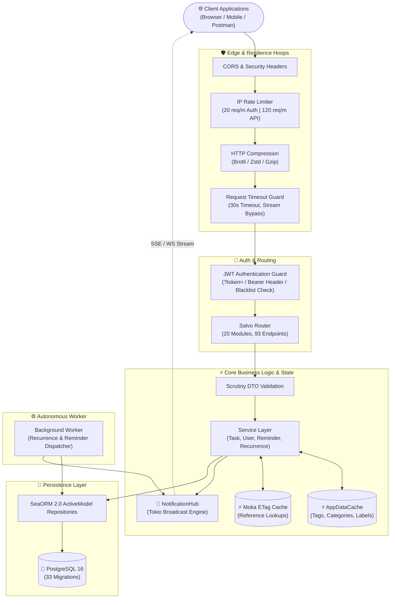

# 🚀 Todo App v2 — Enterprise-Grade Rust Backend Engine

[](https://www.rust-lang.org/)
[](https://salvo.rs)
[](https://www.sea-ql.org/SeaORM/)
[](https://www.postgresql.org/)
[-brightgreen?logo=checkmarx&logoColor=white)](#automated-testing-suite)
[](http://localhost:8080/swagger-ui/)
[](https://www.docker.com/)
[](LICENSE)

An enterprise-grade, asynchronous RESTful API and Real-Time Notification Server engineered in **Rust (2024 Edition)**. Powered by **Salvo 1.1**, **SeaORM 2.0**, **PostgreSQL 16**, and **Scrutiny 0.1**, this system delivers high-throughput task management, dual-transport real-time push (SSE + WebSocket), automated background job scheduling, multi-layer caching with HTTP ETag 304, resilient middleware, and comprehensive observability.

---

## 📑 Table of Contents

- [Architectural Overview](#-architectural-overview)
- [Key Features](#-key-features)
- [Technology Stack](#-technology-stack)
- [System Architecture](#-system-architecture)
- [API Documentation & Explorer](#-api-documentation--explorer)
- [Quick Start Guide](#-quick-start-guide)
  - [1. Running with Docker Compose (Recommended)](#1-running-with-docker-compose-recommended)
  - [2. Running Locally with Cargo](#2-running-locally-with-cargo)
- [Demo Credentials & Seeder](#-demo-credentials--seeder)
- [Automated Testing Suite](#-automated-testing-suite)
- [Directory & Module Structure](#-directory--module-structure)
- [Production Resilience & Observability](#-production-resilience--observability)
- [License](#-license)

---

## 🏛 Architectural Overview

This project is built following strict **Tiered Clean Architecture** principles:

$$\text{Request} \longrightarrow \mathbf{Resilience\ Hoops} \longrightarrow \mathbf{Auth\ Guard} \longrightarrow \mathbf{DTO\ Validation\ (Scrutiny)} \longrightarrow \mathbf{Handler} \longrightarrow \mathbf{Service\ Layer} \longrightarrow \mathbf{SeaORM\ 2.0\ Entity} \longrightarrow \mathbf{PostgreSQL}$$

- **Strict Tier Separation**: Handlers exclusively handle HTTP transport and routing; business logic lives purely within isolated Services; data persistence is managed by SeaORM 2.0 Entities.
- **Fail-Fast Validation**: All inbound payloads are validated using declarative Scrutiny derive macros before reaching application services.
- **Zero-Downtime Asynchronous Concurrency**: Built on the Tokio async runtime with non-blocking channels (`broadcast`, `watch`) for background processing and real-time streaming.
- **Stateless & Scalable**: Designed for horizontal scalability with JWT token separation, externalized database persistence, and optional Redis caching compatibility.

---

## ✨ Key Features

### 1. Comprehensive REST API (93 Endpoints across 20 Modules)
- **Authentication & Security**: Argon2id password hashing, Dual-token JWT (short-lived access + rotating refresh tokens), and thread-safe in-memory token revocation blacklist.
- **Core Task Management**: Hierarchical tasks, subtasks, notes, comments, priority levels, status workflows, and progress tracking.
- **Categorization & Taxonomies**: Multi-dimensional classification using Tags, Categories, and Custom Labels with distinct hex color codes.
- **Collaboration & Social**: Granular collaborator roles (`viewer`, `editor`, `admin`), upvoting/downvoting tasks, and user connections (`follow`, `friend`, `block`).
- **Reminders & Recurrence Engine**: Automated task recurrence schedules (`daily`, `weekly`, `monthly`, `custom`) and scheduled reminders.
- **Geo-Location & Attachments**: Task geolocation coordinates (lat/long/address) and dual attachment support (safe multipart file upload and external URL linking).
- **Audit Trail & Activity Logging**: Comprehensive immutable history tracking task field mutations, actor IDs, and system events.

### 2. Dual-Transport Real-Time Engine (SSE & WebSocket)
- **Server-Sent Events (SSE)** (`GET /api/v1/notifications/stream`): Lightweight unidirectional event stream with automated 15-second keep-alive heartbeats.
- **Full-Duplex WebSockets** (`GET /api/v1/notifications/ws`): Bidirectional communication supporting client commands (`ping`, `mark_read`), 30-second server ping heartbeats, and sub-millisecond broadcast latency.
- **Connection Tracking**: Real-time gauge metrics monitoring active concurrent SSE and WebSocket client connections.

### 3. Automated Background Worker
- Autonomous background worker utilizing `tokio::time::interval` running every 30 seconds.
- Automatically scans and triggers due task reminders and generates new task instances based on configured recurrence frequencies.
- Implements graceful shutdown via `tokio::sync::watch`, ensuring in-flight background transactions complete cleanly before server termination.

### 4. High-Performance Multi-Layer Caching
- **Response Caching (Moka Store)**: In-memory cache for static and reference endpoints (`/statuses`, `/priorities`, `/external-apps`, `/enums`) integrated with Salvo's `CachingHeaders` returning `HTTP 304 Not Modified` when client ETags match.
- **Application Data Cache (`AppDataCache`)**: Thread-safe in-memory caching for classification taxonomies (Tags, Categories, Labels) with automated, instant write-invalidation upon mutative operations (`POST`, `PATCH`, `DELETE`).

### 5. Production Hardening & Resilience
- **Graceful Shutdown**: OS signal listener (`SIGINT` / `SIGTERM`) with a 25-second drain window for active in-flight HTTP requests.
- **Multi-Algorithm Compression**: Automatic HTTP compression supporting `brotli`, `zstd`, `gzip`, and `deflate`.
- **Request Timeout Protection**: 30-second execution deadline on standard HTTP handlers with intelligent bypass for long-lived real-time streams.
- **Rate Limiting**: IP-based rate limiting providing 20 requests/minute on sensitive authentication routes and 120 requests/minute on general endpoints.
- **Security Headers & CORS**: Strict CORS headers, `X-Content-Type-Options: nosniff`, `X-Frame-Options: DENY`, and `X-XSS-Protection`.

---

## 🛠 Technology Stack

| Component | Technology | Description |
|---|---|---|
| **Language** | Rust 2024 Edition | Safe, zero-cost abstractions, blazingly fast concurrency |
| **Web Framework** | [Salvo 1.1.2](https://salvo.rs) | High-performance, modular async web framework with full OpenAPI support |
| **Database ORM** | [SeaORM 2.0.4](https://www.sea-ql.org/SeaORM/) | Async & dynamic ORM built on top of SQLx for PostgreSQL |
| **Database** | PostgreSQL 16 | Relational persistence with 33 applied migrations and foreign key constraints |
| **Validation** | [Scrutiny 0.1.2](https://crates.io/crates/scrutiny) | Declarative struct validation with custom constraints |
| **Async Runtime** | Tokio 1.54 | Industry-standard async event-driven I/O engine |
| **Authentication** | JWT (`jsonwebtoken`) & Argon2id | Secure token minting, rotation, and cryptographic password hashing |
| **Caching** | Moka 0.12 & Custom RwLock | Ultra-fast concurrent in-memory caching with ETag validation |
| **Real-time** | Tokio Broadcast & Salvo WS/SSE | Dual-transport low-latency notification fanout |
| **Documentation** | OpenAPI 3.1, Swagger UI, Scalar | Auto-generated interactive API contracts |
| **Container** | Docker & Docker Compose | Multi-stage production build and service orchestration |

---

## 📐 System Architecture



---

## 📖 API Documentation & Explorer

Interactive API explorers and schema definitions are served directly by the application:

- **Swagger UI**: [`http://localhost:8080/swagger-ui/`](http://localhost:8080/swagger-ui/) — Full interactive sandbox with token authentication and *Try it Out* capabilities.
- **Scalar API Reference**: [`http://localhost:8080/scalar/`](http://localhost:8080/scalar/) — Modern, elegant visual API documentation.
- **OpenAPI 3.1 Spec (JSON)**: [`http://localhost:8080/api-doc/openapi.json`](http://localhost:8080/api-doc/openapi.json) — OpenAPI 3.1 specification ready for API client generators.
- **Postman Collection v2.1.0**: [`postman_collection.json`](file:///home/venom/RustroverProjects/todo-app-v2/postman_collection.json) — 106 pre-configured requests organized by module with **automated JWT token capture** test scripts.
- **Postman Environment**: [`postman_environment.json`](file:///home/venom/RustroverProjects/todo-app-v2/postman_environment.json) — Pre-defined environment variables (`base_url`, `token`, `refresh_token`, `task_id`).

---

## 🚀 Quick Start Guide

### 1. Running with Docker Compose (Recommended)

The easiest way to run the entire backend stack (PostgreSQL 16, automatic database migrations, and the Rust API server) is via Docker Compose:

```bash
# 1. Clone the repository
git clone https://github.com/your-username/todo-app-v2.git
cd todo-app-v2

# 2. Build and launch services in the background
docker compose up -d --build

# 3. Verify health and readiness
curl -i http://localhost:8080/api/v1/health/ready
```

> **Note**: The container automatically applies all 33 database migrations and executes the idempotent demo data seeder on first boot.

### 2. Running Locally with Cargo

#### Prerequisites
- **Rust Toolchain**: 1.85+ (2024 edition compatible)
- **PostgreSQL**: 16+ running on `localhost:5432` with a database named `todo_app`

```bash
# 1. Copy environment template
cp .env.example .env

# 2. Run database migrations and launch server
cargo run

# (Optional) Launch server and populate demo database records:
cargo run -- --seed

# 3. Execute test suite
cargo test --offline
```

---

## 👤 Demo Credentials & Seeder

When booted with `--seed`, `SEED_DEMO_DATA=true`, or via `POST /api/v1/seed/demo`, the system seeds rich relational demo data:

| Account Type | Username | Email | Password | Role |
|---|---|---|---|---|
| **Primary Demo User** | `demo_user` | `demo@todoapp.local` | `Password123!` | Standard User (Tasks, Subtasks, Reminders Owner) |
| **Collaborator User** | `collab_user` | `collab@todoapp.local` | `Password123!` | Collaborator & Activity Peer |

---

## 🧪 Automated Testing Suite

The codebase includes an extensive automated test suite covering unit logic, integration routes, middleware behavior, resilience, and concurrency guarantees:

```bash
cargo test
```

```text
running 38 tests
test core::metrics::tests::test_metrics_counters_and_prometheus_format ... ok
test core::realtime::tests::test_connection_guard_tracks_active_connections ... ok
test core::cache::tests::test_app_data_cache_hit_miss_and_invalidation ... ok
test core::realtime::tests::test_notification_hub_publish_and_subscribe ... ok
test core::routes::tests::test_classifications_require_auth ... ok
test core::routes::tests::test_change_password_requires_auth ... ok
test core::routes::tests::test_connections_and_notifications_require_auth ... ok
test core::routes::tests::test_create_subtask_validation_error ... ok
test core::routes::tests::test_create_task_validation_error ... ok
test core::routes::tests::test_health_ready_probe_endpoint ... ok
test core::routes::tests::test_login_validation_error ... ok
test core::routes::tests::test_logout_endpoint ... ok
test core::routes::tests::test_create_tag_validation_error ... ok
test core::routes::tests::test_health_check_returns_ok ... ok
test core::routes::tests::test_openapi_spec_json_endpoint ... ok
test core::routes::tests::test_method_not_allowed_or_error_catcher ... ok
test core::routes::tests::test_protected_tasks_requires_authorization ... ok
test core::routes::tests::test_realtime_notifications_require_auth ... ok
test core::routes::tests::test_reference_enums_accessible_publicly ... ok
test core::routes::tests::test_register_missing_profile_fields_validation_error ... ok
test core::routes::tests::test_scalar_endpoint ... ok
test core::routes::tests::test_route_not_found_returns_json_and_404 ... ok
test core::routes::tests::test_security_headers_and_cors ... ok
test core::routes::tests::test_swagger_ui_endpoint ... ok
test core::routes::tests::test_refresh_token_validation_error ... ok
test core::routes::tests::test_register_validation_error ... ok
test core::routes::tests::test_static_file_serving ... ok
test core::routes::tests::test_system_metrics_json_and_prometheus ... ok
test core::routes::tests::test_users_endpoints_require_authorization ... ok
test core::seeder::tests::test_demo_seed_constants ... ok
test core::worker::tests::test_recurrence_frequency_advancements ... ok
test core::worker::tests::test_worker_summary_defaults ... ok
test error::api_error::tests::test_error_status_codes_and_payloads ... ok
test core::routes::tests::test_update_me_validation_error ... ok
test utils::jwt::tests::test_token_revocation ... ok
test utils::jwt::tests::test_access_and_refresh_token_type_separation ... ok
test core::routes::tests::test_ws_notifications_query_token_auth_and_upgrade_check ... ok
test core::routes::tests::test_update_progress_validation_error ... ok

test result: ok. 38 passed; 0 failed; 0 ignored; 0 measured; 0 filtered out; finished in 0.44s
```

---

## 📂 Directory & Module Structure

```text
todo-app-v2/
├── .agents/                    # Agent instructions & specialized Salvo/SeaORM skills
├── .dockerignore               # Optimized Docker build context exclusions
├── .env.example                # Canonical environment variable configuration template
├── API_DOC.md                  # Comprehensive markdown API specification
├── Cargo.toml                  # Rust dependencies, profile tuning & workspace settings
├── Dockerfile                  # Multi-stage production container build (Debian slim)
├── README.md                   # Project documentation & portfolio showcase
├── docker-compose.yml          # Container orchestration (Postgres 16 + Rust Backend)
├── docs/                       # DBML schema definitions & API design contracts
│   ├── API_V1.md
│   └── database.dbml
├── migration/                  # SeaORM Migration management
│   ├── Cargo.toml
│   └── src/                    # 33 atomic, idempotent SQL migrations
├── postman_collection.json     # Postman Collection v2.1.0 (106 requests + scripts)
├── postman_environment.json    # Postman environment variables
└── src/
    ├── app.rs                  # Server initialization, signal listeners & graceful shutdown
    ├── config.rs               # Environment variable parsing with safe fallbacks
    ├── main.rs                 # Binary entry point & CLI seed flag parser
    ├── core/
    │   ├── cache/              # Dual-layer caching (AppDataCache & Moka ETag Store)
    │   ├── metrics/            # System metrics collector (Prometheus & JSON)
    │   ├── middleware/         # Auth guard, CORS, rate limiter, resilience hoops
    │   ├── realtime/           # Global NotificationHub (SSE & WebSocket broadcaster)
    │   ├── routes.rs           # Global route assembler, OpenAPI specs & catchers
    │   ├── seeder/             # Idempotent demo database generator
    │   └── worker/             # Background recurrence & reminder scheduler
    ├── error/
    │   └── api_error.rs        # Centralized HTTP error types with JSON catchers
    ├── modules/                # 20 feature modules (DTO -> Handler -> Service)
    │   ├── activity_logs/
    │   ├── attachments/
    │   ├── audit_history/
    │   ├── auth/
    │   ├── categories/
    │   ├── comments/
    │   ├── external_integrations/
    │   ├── labels/
    │   ├── locations/
    │   ├── lookups/
    │   ├── notes/
    │   ├── notifications/
    │   ├── profiles/
    │   ├── recurring_tasks/
    │   ├── reminders/
    │   ├── settings/
    │   ├── sharing/
    │   ├── subtasks/
    │   ├── tags/
    │   ├── tasks/
    │   ├── user_connections/
    │   ├── users/
    │   └── votes/
    └── utils/
        ├── hash.rs             # Argon2id password hashing & verification
        └── jwt.rs              # Dual-token JWT minting, verification & revocation
```

---

## 🛡️ Production Resilience & Observability

### Live Observability Endpoints
- **Liveness Probe**: `GET /health` $\rightarrow$ Fast status check returning `{"status":"ok"}`.
- **Readiness Probe**: `GET /api/v1/health/ready` $\rightarrow$ Deep check actively probing database connectivity, background worker vitality, and caching subsystem status.
- **System Metrics**: `GET /api/v1/metrics` $\rightarrow$ Exposes process uptime, total requests, active real-time SSE/WebSocket streams, worker execution cycles, and cache hit/miss/invalidation statistics in both JSON and Prometheus formats.

---

## 📄 License

Distributed under the **MIT License**. See `LICENSE` for further details.
